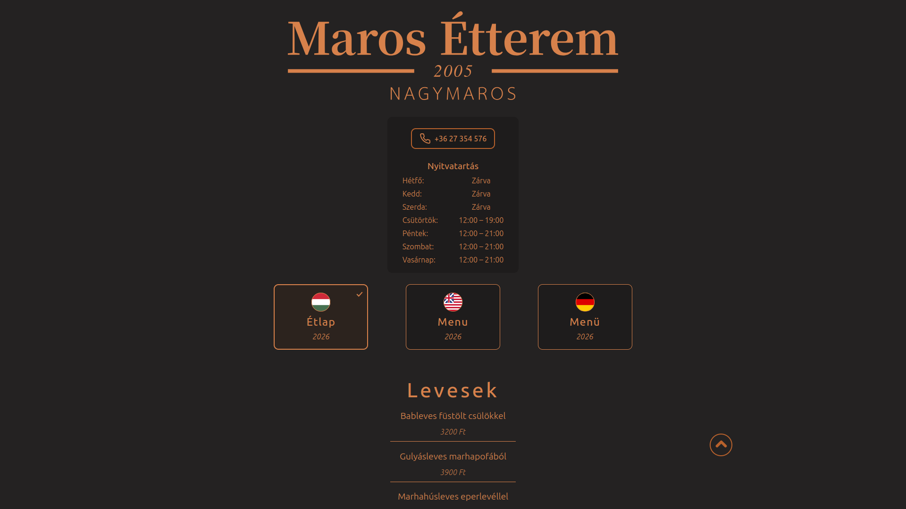
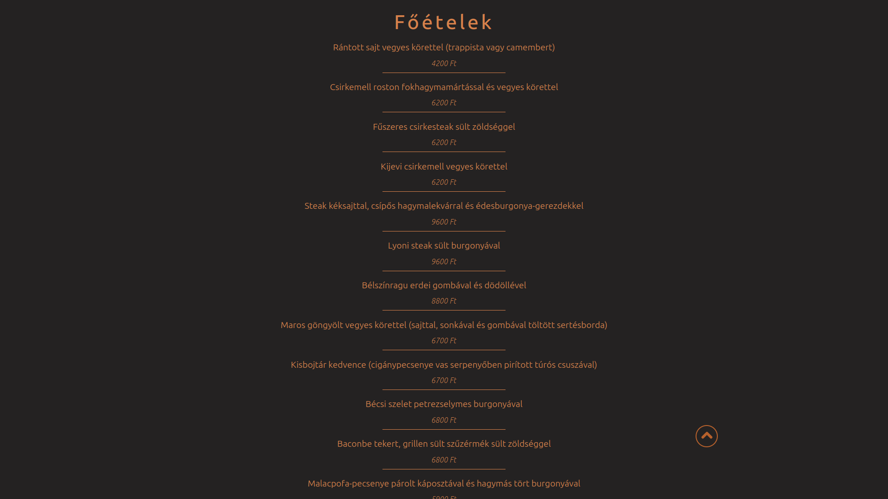
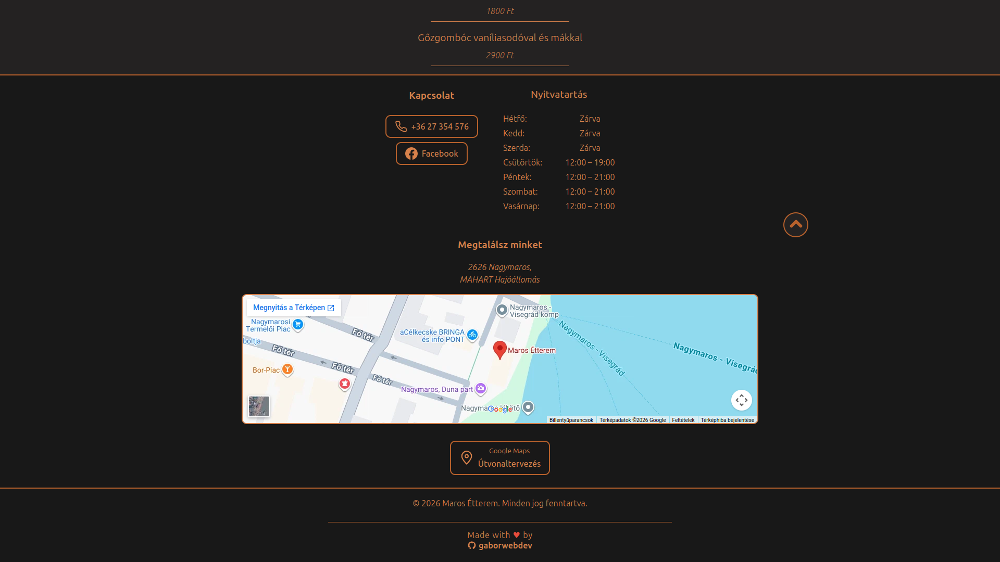
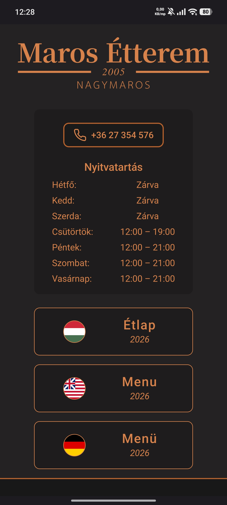
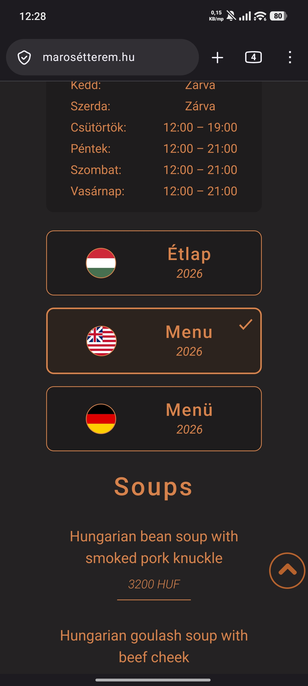
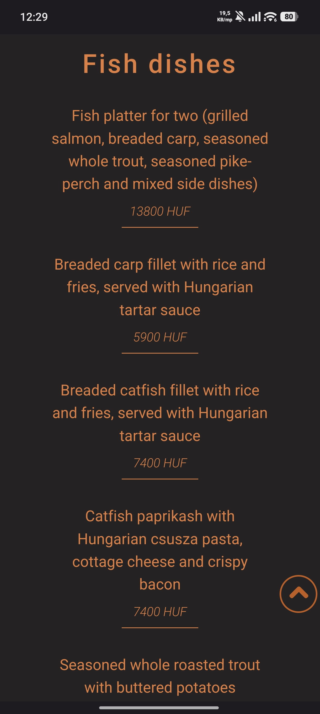
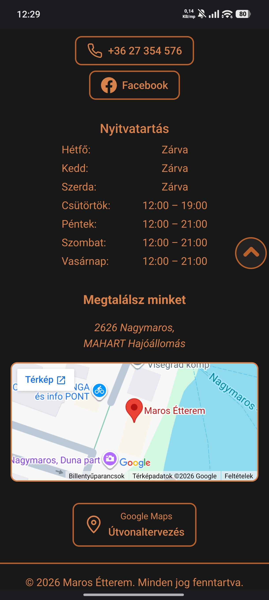

# Maros Menu

[🇬🇧 English](#project-overview) | [🇭🇺 Magyar](#projektbemutató)

## Contents

- [Project overview](#project-overview)
- [Project background](#project-background)
- [Screenshots](#screenshots)
- [Features](#features)
- [Technology](#technology)
- [Technical documentation](#technical-documentation)
  - [About the project](#about-the-project)
  - [Technology stack](#technology-stack)
  - [Languages and localization](#languages-and-localization)
  - [Data structure](#data-structure)
  - [Application architecture](#application-architecture)
  - [Project structure](#project-structure)
  - [Installation and development](#installation-and-development)
  - [Tests](#tests)
  - [Utility scripts and data archives](#utility-scripts-and-data-archives)


## Project overview

**A multilingual digital restaurant menu built with React.**

[Live website](https://marosétterem.hu)

Maros Menu is a responsive digital restaurant menu developed for Maros
Étterem in Nagymaros, Hungary, a popular destination with many
international visitors.

The goal was to give guests quick access to the menu in multiple
languages without printing and maintaining separate paper menus for each
language. Guests scan a QR code printed on the restaurant's menus or
placed on the back of the staff's ordering tablets to open the menu on
their own devices.

The menu is available in Hungarian, English and German. Guests can also
use their device's built-in translation features to view it in other
languages.

Menu content is managed through structured JSON data, separate from the
user interface.

## Project Background

Maros Menu is not a tutorial project or a portfolio exercise. It is a
real-world application developed for a working restaurant.

The earliest recorded Git commit dates back to **November 15, 2022**.

Over the years, I have revisited, refined and improved the application
as my programming knowledge and development skills have grown. Rather
than starting over to present a supposedly perfect result, I have
preserved the project's history and earlier approaches. The evolution of
the application reflects my own journey as a developer.

**The application is still actively used in a live environment today.**

## Screenshots

### Desktop -- Main page



### Desktop -- Main courses



### Desktop -- Contact and location



### Mobile

<table>
  <tr>
    <td align="center"></td>
    <td align="center"></td>
  </tr>
  <tr>
    <td align="center">Initial mobile screen on page load</td>
    <td align="center">English menu</td>
  </tr>
  <tr>
    <td align="center"></td>
    <td align="center"></td>
  </tr>
  <tr>
    <td align="center">English fish dishes</td>
    <td align="center">Contact and location</td>
  </tr>
</table>


## Features

-   Hungarian, English and German menu
-   QR-code access to the digital menu
-   Responsive desktop and mobile layouts
-   JSON-based menu content
-   Localized dish names and prices
-   Restaurant contact information and opening hours
-   Embedded Google Maps and route planning link
-   Back-to-top navigation

## Technology

The application uses React 18.2 and JavaScript, with Create React App
for development and production builds. Menu and restaurant content is
stored in JSON. The detailed stack and the role of each tool are covered
in the technical documentation below.


## Technical Documentation

### About the project

The current codebase is a refinement of an earlier implementation. The
work focuses on improving the existing data handling and component
structure, with the aim of making the application easier to understand
and maintain. The project deliberately retains its historical data and
migration sources so that earlier approaches remain traceable.

### Technology stack

| Technology | Purpose |
|---|---|
| React 18.2 | Component-based user interface |
| JavaScript | Application logic |
| Create React App (`react-scripts` 5.0.1) | Development server, build, and test commands |
| CSS | User interface styling |
| JSON | Restaurant, language, and menu data |
| Jest | Test runner |
| React Testing Library | React component testing |
| `@testing-library/user-event` | Simulating user interactions in tests |
| `@testing-library/jest-dom` | Additional DOM assertions |

React and React DOM are production dependencies. `react-scripts` and the
testing packages are development dependencies (`devDependencies`).

### Languages and localization

The application currently supports three languages:

| Language code | Language | Selector label |
|---|---|---|
| `hu` | Hungarian | Étlap |
| `en` | English | Menu |
| `de` | German | Menü |

The language selector configuration is stored in
`src/data/languages.json`. The selected language code is passed to the
`getLanguageMenu` utility, which prepares the menu data for the selected
language.

The document language attribute (`html lang`) is updated when the
visitor changes the selected language.

### Data structure

Application content is stored in separate JSON files. This keeps menu
content and restaurant information independent from React component
logic.

#### Current menu

`src/data/menu/current/menu.json`

The current menu consists of categories and their dishes. Its main
fields are:

-   `currency`: currency labels mapped to language codes;
-   `categories`: the list of menu categories;
-   `uid`: unique identifiers for categories and dishes;
-   `title`: category title translated by language;
-   `dishes`: the dishes belonging to a category;
-   `hu`, `en`, `de`: localized dish names;
-   `price`: the dish price.

The uploaded project snapshot contained 5 categories and 42 dishes. Menu
content can change, so these numbers are not fixed application
requirements.

#### Language configuration

`src/data/languages.json`

This file contains the supported language codes, selector labels, and
the information required to display the corresponding flag images.

#### Restaurant information

`src/data/restaurant.json`

This file stores restaurant information, including:

-   restaurant name and phone number;
-   address;
-   Facebook page URL;
-   Google Maps embed URL;
-   weekly opening hours.

#### Archived data

Previous menu versions and migration sources are retained in
`src/data/archive/` and `src/data/menu/archive/`. These files are not
used as the current application data source; they are kept for
historical reference and to preserve earlier data structures.

### Application architecture

The application is built from focused UI components and compositions
made up of multiple components.

-   **`components/`** -- individual UI elements such as the header,
    language selector, menu, phone number, opening hours, and
    back-to-top button.
-   **`compositions/`** -- larger UI sections, including the combined
    phone-and-opening-hours section and the footer.
-   **`data/`** -- application JSON data and archives.
-   **`utils/`** -- data preparation helpers separated from presentation
    logic.
-   **`css/`** -- shared application styles and variables.

#### Main components

| Element | Responsibility |
|---|---|
| `App` | Main application component; coordinates data, state, and primary UI sections |
| `Header` | Displays the restaurant logo |
| `LanguageSelector` | Displays available languages and handles language selection |
| `Menu` | Displays categories and dishes in the selected language |
| `Phone` | Displays the restaurant phone number |
| `OpeningTimes` | Displays opening hours |
| `StickyUpButton` | Scrolls back to the top of the page |
| `PhoneAndOpening` | Combines the phone number and opening hours into one UI section |
| `Footer` | Displays contact information, address, map, and social link |

#### Language selection data flow

1.  The application imports the language configuration and restaurant
    data.
2.  The visitor selects a language.
3.  The selected language code is stored in application state.
4.  The `getLanguageMenu` utility prepares the menu structure for the
    selected language.
5.  The `Menu` component renders the categories, dishes, prices, and
    currency.

### Project structure

The main repository directories and files:

```text
maros-menu/
├── public/                  # HTML template, manifest, and public icons
├── scripts/                 # Data preparation and migration scripts
│   └── outputs/              # Migration outputs
├── screenshots/              # Desktop and mobile project screenshots
├── src/
│   ├── assets/               # Logo and other static assets
│   ├── components/           # Individual React components
│   ├── compositions/         # UI sections composed of multiple components
│   ├── css/                  # Shared CSS files
│   ├── data/                 # Current and archived JSON data
│   ├── utils/                # Data preparation utilities
│   ├── App.jsx               # Main application component
│   ├── App.test.js           # Application tests
│   ├── index.js              # React entry point
│   └── setupTests.js         # Test environment setup
├── .gitignore
├── package.json
├── package-lock.json
└── README.md
```

### Installation and development

#### Prerequisites

-   Node.js
-   npm

#### Clone the repository

```bash
git clone https://github.com/gdobcsi/maros-menu.git
cd maros-menu
```

#### Install dependencies

For a reproducible installation based on `package-lock.json`:

```bash
npm ci
```

#### Start the development server

```bash
npm start
```

Create React App starts the application at `http://localhost:3000` by
default.

#### Create a production build

```bash
npm run build
```

This creates an optimized production build in the `build/` directory.

### Tests

The project uses Jest and React Testing Library.

```bash
npm test
```

To run the tests once without watch mode:

```bash
npm test -- --watchAll=false
```

The current tests check that the language selector buttons render and
that selecting English displays the English menu and its associated
currency.

The `src/setupTests.js` file loads the `jest-dom` matchers and provides
a test-only mock for the browser's `IntersectionObserver` API, which is
used by `StickyUpButton`.

### Utility scripts and data archives

The `scripts/` directory contains Node.js utilities for data
preparation:

-   `scripts/uidGenerator.js` -- helper functions for generating unique
    identifiers.
-   `scripts/migration.js` -- transforms older menu data into the newer
    data structure.

The migration script reads
`src/data/menu/archive/migrated/2026_summer/source.json` and writes its
output to the `scripts/outputs/` directory. Run it from the project
root:

```bash
node scripts/migration.js
```

These are development and data-maintenance tools; they are not part of
the browser application runtime.

---


# Maros Menu – Magyarul

## Tartalomjegyzék

- [Projektbemutató](#projektbemutató)
- [A projekt története](#a-projekt-története)
- [Képernyőképek](#képernyőképek)
- [Funkciók](#funkciók)
- [Technológiák](#technológiák)
- [Technikai dokumentáció](#technikai-dokumentáció)
  - [A projektről](#a-projektről)
  - [Technológiai háttér](#technológiai-háttér)
  - [Nyelvek és lokalizáció](#nyelvek-és-lokalizáció)
  - [Adatstruktúra](#adatstruktúra)
  - [Alkalmazásfelépítés](#alkalmazásfelépítés)
  - [Projektstruktúra](#projektstruktúra)
  - [Telepítés és fejlesztés](#telepítés-és-fejlesztés)
  - [Tesztek](#tesztek)
  - [Segédscriptek és adatarchiválás](#segédscriptek-és-adatarchiválás)


## Projektbemutató

**Többnyelvű digitális étlap React használatával.**

[Élő weboldal](https://marosétterem.hu)

A Maros Menu egy reszponzív digitális étlap, amely a nagymarosi Maros
Étterem számára készült. Az étterem népszerű turisztikai célpont,
jelentős nemzetközi vendégforgalommal.

A fejlesztés fő célja az volt, hogy a vendégek gyorsan és egyszerűen
hozzáférjenek az étlaphoz több nyelven, anélkül, hogy minden nyelvhez
külön papíralapú étlapokat kellene nyomtatni és karbantartani. A
vendégek beolvashatják az éttermi étlapokon vagy a felszolgálók
rendelésfelvételre használt tabletjeinek hátoldalán elhelyezett
QR-kódot, így saját eszközükön azonnal megnyithatják a digitális
étlapot.

Az étlap magyar, angol és német nyelven érhető el. A vendégek saját
eszközük beépített fordítási lehetőségeit is használhatják további
nyelvek megjelenítéséhez.

Az étlap tartalma strukturált JSON-adatokban található, elkülönítve a
felhasználói felülettől.

## A projekt története

A Maros Menu nem tanfolyami feladat vagy portfóliógyakorlat, hanem egy
valódi étterem számára készült alkalmazás.

A Git-előzményekben szereplő legkorábbi commit dátuma: **2022. november
15.**

Az évek során rendszeresen visszatértem hozzá, továbbcsiszoltam és
fejlesztettem, ahogy a programozási tudásom és fejlesztői tapasztalatom
bővült. Ahelyett, hogy mindent újrakezdtem volna egy tökéletesnek tűnő
végeredmény bemutatásáért, megőriztem a projekt történetét és a korábbi
megoldásokat is. Az alkalmazás fejlődése egyben a saját fejlesztői
utamat is tükrözi.

**Az alkalmazás ma is éles környezetben működik.**

## Képernyőképek

### Asztali nézet -- Főoldal


### Asztali nézet -- Főételek


### Asztali nézet -- Kapcsolat és térkép


### Mobilnézet

<table>
  <tr>
    <td align="center"></td>
    <td align="center"></td>
  </tr>
  <tr>
    <td align="center">Mobil kezdőképernyő betöltéskor</td>
    <td align="center">Angol étlap</td>
  </tr>
  <tr>
    <td align="center"></td>
    <td align="center"></td>
  </tr>
  <tr>
    <td align="center">Angol halételek</td>
    <td align="center">Kapcsolat és térkép</td>
  </tr>
</table>

## Funkciók

-   Magyar, angol és német nyelvű étlap
-   QR-kódos hozzáférés a digitális étlaphoz
-   Reszponzív asztali és mobil megjelenés
-   JSON-alapú étlapadatok
-   Lokalizált ételnevek és árak
-   Éttermi elérhetőségek és nyitvatartás
-   Beágyazott Google Maps és útvonaltervezési hivatkozás
-   Vissza az oldal tetejére funkció

## Technológiák

Az alkalmazás React 18.2 és JavaScript használatával készült. A
fejlesztési és buildfolyamatot a Create React App biztosítja, az étlap
és az éttermi adatok JSON-fájlokban találhatók. A részletes
technológiai háttér és az egyes eszközök szerepe a technikai
dokumentációban olvasható.

------------------------------------------------------------------------


## Technikai dokumentáció

### A projektről

A jelenlegi kódbázis egy korábbi megvalósítás továbbfejlesztett,
strukturálisan átdolgozott változata. A munka a meglévő adatkezelés és
komponensstruktúra javítására összpontosít, hogy az alkalmazás
átláthatóbb és könnyebben karbantartható legyen. A projekt megőrizte a
korábbi adatokat és migrációs forrásokat is, így a régebbi megoldások
visszakövethetők maradtak.

### Technológiai háttér

| Technológia | Szerepe |
|---|---|
| React 18.2 | Komponensalapú felhasználói felület |
| JavaScript | Alkalmazáslogika |
| Create React App (`react-scripts` 5.0.1) | Fejlesztői szerver, build és tesztparancsok |
| CSS | A felület megjelenítése |
| JSON | Éttermi, nyelvi és étlapadatok tárolása |
| Jest | Tesztfuttató |
| React Testing Library | React-komponensek tesztelése |
| `@testing-library/user-event` | Felhasználói interakciók szimulálása tesztekben |
| `@testing-library/jest-dom` | Kiegészítő DOM-ellenőrzések |

A React és a React DOM production függőség. A `react-scripts` és a
teszteléshez használt csomagok fejlesztői függőségek
(`devDependencies`).

### Nyelvek és lokalizáció

Az alkalmazás jelenleg három nyelvet támogat:

| Nyelvkód | Nyelv | Nyelvválasztó felirata |
|---|---|---|
| `hu` | Magyar | Étlap |
| `en` | Angol | Menu |
| `de` | Német | Menü |

A nyelvválasztó konfigurációja a `src/data/languages.json` fájlban
található. A kiválasztott nyelvkód alapján a `getLanguageMenu`
segédfüggvény előállítja az adott nyelvhez tartozó étlapadatokat.

A dokumentum nyelvi attribútuma (`html lang`) a kiválasztott nyelvhez
igazodik.

### Adatstruktúra

Az alkalmazás tartalma külön JSON-fájlokban található, így az étlap és
az éttermi információk a React-komponensek logikájától elkülönítve
kezelhetők.

#### Aktuális étlap

`src/data/menu/current/menu.json`

Az aktuális étlap kategóriákból és az azokhoz tartozó ételekből áll. A
legfontosabb mezők:

-   `currency`: a nyelvkódokhoz rendelt pénznemjelölések;
-   `categories`: az ételkategóriák listája;
-   `uid`: egyedi azonosító a kategóriákhoz és az ételekhez;
-   `title`: a kategória nyelvenkénti elnevezése;
-   `dishes`: a kategóriához tartozó ételek;
-   `hu`, `en`, `de`: az étel neve a támogatott nyelveken;
-   `price`: az étel ára.

A feltöltött projektverzióban az aktuális étlap 5 kategóriát és 42 ételt
tartalmazott. Az étlap tartalma változhat, ezért ez a szám nem az
alkalmazás működésének állandó feltétele.

#### Nyelvi konfiguráció

`src/data/languages.json`

A fájl tartalmazza a támogatott nyelvek kódját, a nyelvválasztó
feliratát, valamint a zászlóképekhez és megjelenítésükhöz szükséges
adatokat.

#### Éttermi adatok

`src/data/restaurant.json`

A fájlban találhatók az étterem adatai, többek között:

-   név és telefonszám;
-   cím;
-   Facebook-oldal hivatkozása;
-   Google Maps beágyazási URL;
-   heti nyitvatartás.

#### Archivált adatok

A korábbi étlapverziók és migrációs források a `src/data/archive/` és a
`src/data/menu/archive/` könyvtárakban maradtak meg. Ezek nem az
alkalmazás aktuális adatforrásai; történeti referenciaként és a korábbi
adatszerkezetek megőrzése céljából szerepelnek a repositoryban.

### Alkalmazásfelépítés

Az alkalmazás kisebb, jól körülhatárolt komponensekből és több
komponensből összeállított kompozíciókból épül fel.

-   **`components/`** -- önálló felületi elemek, például a fejléc, a
    nyelvválasztó, az étlap, a telefonszám, a nyitvatartás és a vissza
    az oldal tetejére gomb.
-   **`compositions/`** -- összetettebb felületi egységek, például a
    telefonszámot és nyitvatartást összefogó rész, valamint a lábléc.
-   **`data/`** -- az alkalmazás JSON-adatforrásai és archívumai.
-   **`utils/`** -- a megjelenítéstől elkülönített adat-előkészítő
    segédfüggvények.
-   **`css/`** -- az alkalmazás közös stílus- és változófájljai.

#### Főbb komponensek

| Elem | Felelősség |
|---|---|
| `App` | Az alkalmazás fő komponense; összefogja az adatokat, az állapotot és a fő felületi egységeket |
| `Header` | Az étterem logójának megjelenítése |
| `LanguageSelector` | A nyelvek megjelenítése és a nyelvválasztás kezelése |
| `Menu` | A kiválasztott nyelvű kategóriák és ételek megjelenítése |
| `Phone` | Az étterem telefonszámának megjelenítése |
| `OpeningTimes` | A nyitvatartás megjelenítése |
| `StickyUpButton` | Visszagörgetés az oldal tetejére |
| `PhoneAndOpening` | A telefonszám és a nyitvatartás közös felületi egysége |
| `Footer` | Kapcsolati adatok, cím, térkép és közösségi hivatkozás megjelenítése |

#### A nyelvváltás adatfolyama

1.  Az alkalmazás importálja a nyelvi konfigurációt és az éttermi
    adatokat.
2.  A felhasználó kiválaszt egy nyelvet.
3.  A kiválasztott nyelvkód az alkalmazás állapotába kerül.
4.  A `getLanguageMenu` segédfüggvény előállítja a kiválasztott nyelvhez
    tartozó étlapstruktúrát.
5.  A `Menu` komponens megjeleníti a kategóriákat, az ételeket, az
    árakat és a pénznemet.

### Projektstruktúra

A repository főbb könyvtárai és fájljai:

```text
maros-menu/
├── public/                  # HTML-sablon, manifest és publikus ikonok
├── scripts/                 # Adat-előkészítő és migrációs scriptek
│   └── outputs/             # Migrációs kimenetek
├── screenshots/              # Asztali és mobil képernyőképek
├── src/
│   ├── assets/               # Logó és egyéb statikus erőforrások
│   ├── components/           # Önálló React-komponensek
│   ├── compositions/         # Több komponensből álló felületi egységek
│   ├── css/                  # Közös CSS-fájlok
│   ├── data/                 # Aktuális és archivált JSON-adatok
│   ├── utils/                # Adatfeldolgozó segédfüggvények
│   ├── App.jsx               # Fő alkalmazáskomponens
│   ├── App.test.js           # Alkalmazástesztek
│   ├── index.js              # React belépési pont
│   └── setupTests.js         # Tesztkörnyezet beállítása
├── .gitignore
├── package.json
├── package-lock.json
└── README.md
```

### Telepítés és fejlesztés

#### Előfeltételek

-   Node.js
-   npm

#### Repository klónozása

```bash
git clone https://github.com/gdobcsi/maros-menu.git
cd maros-menu
```

#### Függőségek telepítése

A `package-lock.json` alapján reprodukálható telepítéshez:

```bash
npm ci
```

#### Fejlesztői szerver indítása

```bash
npm start
```

A Create React App alapértelmezés szerint a `http://localhost:3000`
címen indítja el az alkalmazást.

#### Production build készítése

```bash
npm run build
```

A parancs optimalizált, éles környezetben kiszolgálható buildet készít a
`build/` könyvtárba.

### Tesztek

A projekt tesztjeit a Jest és a React Testing Library futtatja.

```bash
npm test
```

Egyszeri, nem interaktív futtatás:

```bash
npm test -- --watchAll=false
```

A jelenlegi tesztek ellenőrzik a nyelvválasztó gombok megjelenését,
valamint azt, hogy angol nyelvre váltáskor megjelenik az angol étlap és
a hozzá tartozó pénznem.

A `src/setupTests.js` fájl a `jest-dom` kiegészítést tölti be, és
tesztkörnyezetben helyettesíti a böngészőben elérhető
`IntersectionObserver` API-t, amelyet a `StickyUpButton` használ.

### Segédscriptek és adatarchiválás

A `scripts/` könyvtárban adat-előkészítést segítő Node.js scriptek
találhatók:

-   `scripts/uidGenerator.js` -- egyedi azonosítók előállítását segítő
    függvények.
-   `scripts/migration.js` -- korábbi étlapadatok új adatszerkezetbe
    történő átalakítása.

A migrációs script a
`src/data/menu/archive/migrated/2026_summer/source.json` fájlt olvassa
be, és az eredményt a `scripts/outputs/` könyvtárba írja. A script a
projekt gyökérkönyvtárából az alábbi paranccsal futtatható:

```bash
node scripts/migration.js
```

Ezek fejlesztési és adatkarbantartási segédeszközök, nem részei a
böngészőben futó alkalmazásnak.

------------------------------------------------------------------------
